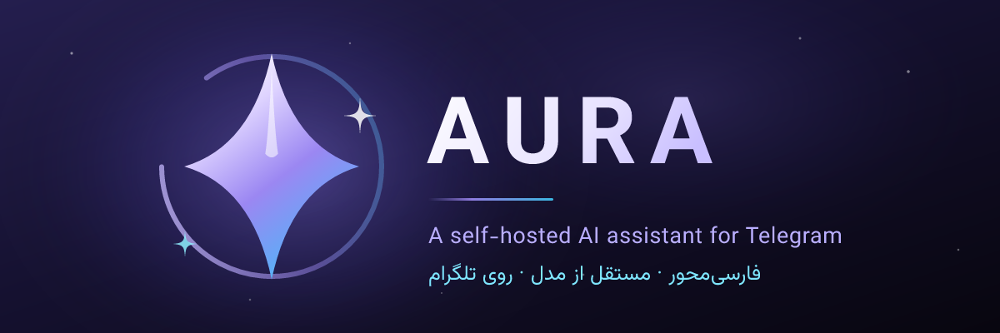

<p align="center">
  
</p>

# Aura

**A self-hosted AI assistant for Telegram — bilingual, provider-agnostic, and careful about the truth.**

[](https://github.com/canoheil/Aura/actions/workflows/tests.yml)
[](LICENSE)
[](pyproject.toml)

[English](README.md) · [فارسی](README.fa.md)

Aura is a personal assistant that lives in Telegram: she holds a conversation,
remembers what matters, reads the photos, stickers, documents and voice notes
people send her, searches the web when a question is about something that has
changed recently, sets one-shot and repeating reminders, and draws pictures — vector drawings
locally, photographs through an image service you can leave disabled.

It runs as one Python process against a single SQLite file. No Docker, no Redis,
no Postgres, no webhook, no cloud account beyond the model API key.

---

## Why Aura

**It speaks Persian first.** Persian is the default interface language, not a
translation bolted on afterwards: the catalog carries both languages, the tests
fail on a missing string, and the local SVG renderer shapes Persian text
correctly instead of reversing it. English is one `/language en` away.

**It is not tied to one model vendor.** The same agent runtime runs on Gemini's
native SDK or on any `POST /chat/completions` gateway — OpenAI, OpenRouter, Groq,
DeepSeek, Together, Fireworks, vLLM, LM Studio, Ollama. Switching providers never
weakens the tool loop, the budgets or the evidence checks, and it happens from
Telegram without a restart.

**It would rather say "I can't verify that" than guess.** A model cannot tell
that its own knowledge is stale. Aura decides in code — not in the prompt —
whether a question is time-dependent, forces a search for those, and refuses to
present a remembered fact as current when the search comes back empty.

**It understands the media people actually send.** Photos, image documents,
stickers (including animated and video stickers), voice notes, audio, video,
video notes and files all reach the model, each with the framing it needs.

**Every knob is editable from Telegram.** `/admin` changes the provider, the
model, the keys, the budgets, the feature switches and the persona — with
validation, an audit trail, and encrypted storage for secrets.

**Your data stays yours.** Conversation history, memory and reminders live in your
`bot.db`. Nothing is sent anywhere except the requests needed to answer a
message, and `/deletemydata` wipes a person's data in one transaction.

## Features

| Area | What you get |
| --- | --- |
| Conversation | Persistent per-chat history in SQLite, rolling summaries, long-term memory with `search`/`save`/`forget` tools |
| Models | Gemini (native) or any OpenAI-compatible gateway; per-user model choice, `/admin` switching |
| Retrieval | Guarded You.com web search with a freshness gate, page opening, weather from Open-Meteo (keyless) |
| Media in | Photos, image documents, stickers, voice, audio, video, video notes, documents, YouTube links |
| Media out | Photorealistic images via Pollinations (optional), vector images rendered locally from SVG, Reddit memes (keyless) |
| Secretary mode | Answers the owner's Telegram Business account: customers get a short, honest assistant reply; no tools, no owner context, `/secretary` pause switch |
| Reminders | One-shot and repeating reminders with per-user timezones, Persian clock words and Solar Hijri dates, snooze/done/skip/stop buttons, mention delivery in groups |
| Groups | Whitelisted groups only, trigger words and mentions, speaker-aware replies, conservative sticker cooldowns |
| Operations | `/admin` panel, health checks, versioned schema migrations, startup service scripts, per-user quotas |
| Languages | Persian (default) and English, per user, with a full interface catalog |
| Privacy | `/deletemydata` (preview → confirm), no third-party analytics, secrets never echoed back |

## Quick start

You need a Telegram bot token from [@BotFather](https://t.me/BotFather) and one
model API key: a [Google AI Studio](https://aistudio.google.com/apikey) key, or
any OpenAI-compatible key.

```bash
git clone https://github.com/canoheil/Aura.git
cd Aura

python3 -m venv .venv
source .venv/bin/activate
pip install -r requirements.txt

cp .env.example .env
# edit .env: TELEGRAM_BOT_TOKEN and GEMINI_API_KEY (or the OPENAI_* trio)

python bot.py
```

Aura uses Telegram long polling — no webhook, no public port, no TLS
certificate. Message your bot once it logs `Bot is running`.

Two things worth doing on the first run:

- set `FOUNDER_USER_ID` to your own Telegram ID (`/whoami` tells you), so
  `/admin`, `/settings` and the unrestricted quota belong to you;
- keep `bot.db` out of Git. It holds every message, and `repo_guard.py` blocks a
  commit that tries anyway.

`requirements-pinned.txt` pins the exact versions the current release was
validated against; use it instead of `requirements.txt` when you need a
reproducible environment.

## Commands

| Command | What it does |
| --- | --- |
| `/start` | Greeting, current model, command list |
| `/new` | Start a fresh conversation (keeps memory and reminders) |
| `/model`, `/models` | Show or change the model; list what the provider exposes |
| `/memory`, `/remember <text>`, `/forget <text>` | Read, add to, or delete from long-term memory |
| `/stats` | Conversation and memory statistics |
| `/image <prompt>` | Generate an image, or edit the photo you replied to |
| `/remind <when> <task>` | Create a reminder, one-shot or repeating |
| `/reminders`, `/cancelreminder <id>`, `/timezone` | Manage reminders and the per-user timezone |
| `/secretary` | Secretary mode: status, `/secretary off`, `/secretary on`, `/secretary forget` |
| `/language` | Switch between Persian and English |
| `/usage` | Today's counter, the limits and when they reset |
| `/deletemydata` | Preview, then delete everything stored about you |
| `/whoami` | Your Telegram ID and founder status |
| `/settings` | Owner-only: manage the group whitelist |
| `/admin` | Founder/admin panel: settings, provider test, audit log |

Commands are not the only interface: ordinary sentences work too. „۱۰ دقیقه دیگه
یادم بنداز آب بخورم“, „هوای تهران چطوره؟“, „یه میم بده“ and „عکس بساز از یک گربه
فضانورد“ are handled as requests, not as text.

## Documentation

| Document | Contents |
| --- | --- |
| [Configuration](docs/configuration.md) | Every environment variable, precedence, `/admin`, persona, quotas |
| [Model providers](docs/providers.md) | Gemini vs. OpenAI-compatible, keys, encryption, graceful degradation |
| [Media](docs/media.md) | Inbound photos/audio/video/stickers/files, image generation, SVG, memes |
| [Search and retrieval](docs/search.md) | Freshness gate, evidence rules, cost bounds, weather |
| [Reminders](docs/reminders.md) | Parsing, storage, delivery, edge cases |
| [Secretary mode](docs/business.md) | Telegram Business: what customers get, the boundary, the owner's controls |
| [Data and privacy](docs/data-and-privacy.md) | What is stored, `/deletemydata`, migrations, backups |
| [Deployment](docs/deployment.md) | Running as a service, cPanel, concurrency, health checks, upgrades |
| [Architecture](docs/architecture.md) | Module map, agent loop, prompt layers, design principles |

Contributor-facing material lives in [CONTRIBUTING.md](CONTRIBUTING.md); the
palette, the logos and the notes for re-rendering them in
[`assets/brand/`](assets/brand/README.md); licensing and third-party attribution
in [NOTICE](NOTICE).

## How it works

A message arrives, `bot.py` decides what kind of turn it is, and everything else
is a tool the model can call through a bounded agent loop:

```
Telegram ─▶ handler ─▶ prompt layers ─▶ agent loop ─▶ tool registry ─▶ model
                             │                  │
                    identity, boundaries,   web search · weather · memes ·
                    persona, freshness      images · SVG · files · memory ·
                                            reminders · stickers
```

The loop has a fixed budget (`AGENT_MAX_ROUNDS`, `AGENT_MAX_TOOL_CALLS`), merges
duplicate tool calls inside a turn, and stops as soon as the evidence is enough.
Nothing about a provider is hard-coded into the handlers, so the same turn works
on Gemini or on a local Ollama model.

| File | Responsibility |
| --- | --- |
| `bot.py` | Telegram handlers, prompt assembly, delivery |
| `tool_system.py` | Tool registry and the bounded agent loop |
| `providers.py` | Gemini and OpenAI-compatible clients behind one interface |
| `settings_store.py`, `admin_panel.py` | Runtime settings, the `/admin` panel, audit trail |
| `aura_identity.py`, `aura_personality_boundary.py`, `persona.py` | Who Aura is, and where style is allowed to change |
| `freshness_policy.py`, `answer_quality.py` | When a search is mandatory, and what a trustworthy answer looks like |
| `reminder_time.py`, `recurrence.py`, `reminders.py`, `business_mode.py`, `memory_bridge.py`, `data_deletion.py` | Time and repeat parsing, secretary mode, durable state and its lifecycle |
| `telegram_formatting.py`, `i18n.py` | Copy-safe HTML and the Persian/English catalog |
| `sticker_manager.py`, `sticker_vision.py`, `svg_image.py`, `pollinations_image.py`, `meme_api.py`, `weather_api.py` | Optional capabilities |

More detail — including why the prompt is layered the way it is — is in
[docs/architecture.md](docs/architecture.md).

## Requirements

- Python 3.11+
- A Telegram bot token
- One model provider key: Gemini (`GEMINI_API_KEY`) or any OpenAI-compatible gateway (`OPENAI_API_KEY`, `OPENAI_BASE_URL`, `OPENAI_MODEL`)
- Optional: `YOU_API_KEY` for web search, `POLLINATIONS_API_KEY` for photo generation
- No database server, no Docker, no reverse proxy

## Tests

The suite is hermetic — fake Telegram and model clients, no API keys, no network —
and runs in about ten seconds:

```bash
pip install -r requirements-dev.txt
python -m pytest
ruff check .
```

CI runs both jobs on every push and pull request
([`.github/workflows/tests.yml`](.github/workflows/tests.yml)). See
[CONTRIBUTING.md](CONTRIBUTING.md) for the layout, the pre-commit hooks and the
rules a pull request is expected to follow.

## Project status

Aura is developed in the open and deployed for real use. `main` is the only
supported branch, and every change lands through a pull request that has to pass
the test suite and the linter. Interfaces may still move; the database schema is
versioned and migrated forward, never silently rewritten.

## Contributing

Bug reports, fixes and features are welcome — start with
[CONTRIBUTING.md](CONTRIBUTING.md). Please report vulnerabilities privately as
described in [SECURITY.md](SECURITY.md) rather than in a public issue.

## License

Released under the [MIT License](LICENSE). Copyright (c) 2026 canoheil and Aura
contributors.

Bundled third-party assets and dependency licenses are listed in [NOTICE](NOTICE).
The Vazirmatn fonts in `assets/fonts/` are distributed under the SIL Open Font
License 1.1, reproduced in `assets/fonts/OFL.txt`.
