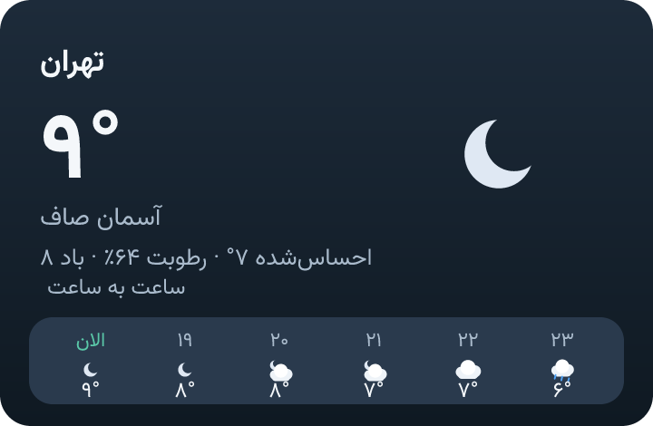
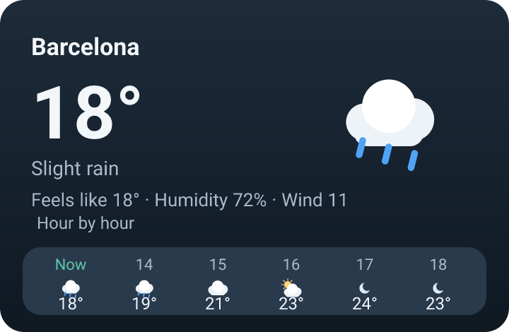

# Weather and the weather card

Weather is keyless, needs no extra dependency, and runs fine on shared hosting:
it is a pair of plain HTTPS calls with `requests`. The picture Aura sends
beside her answer is drawn on the same machine, so it costs nothing either.

## The tool

`weather_api.py` registers a `get_weather` tool. Aura passes the city exactly as
the user wrote it (Persian or English); the module resolves it with the Open-Meteo
geocoding API, fetches current conditions, a 3-day forecast and the next twelve
hours, maps WMO weather codes to Persian descriptions, and caches a city for
`WEATHER_CACHE_TTL` seconds so repeated questions cannot hammer the free service.
Only a compact summary reaches the model — never the raw payload.

For an explicit weather question with a named city («هوای تهران چطوره؟»,
«آب و هوا مشهد», "weather in Berlin"), Aura resolves and fetches the conditions
**before** the model answers, so a city with a famous namesake cannot be
silently swapped. Talk-about sentences ("درباره هواشناسی چیکار کنم", "چند درجه
سرد شده") and image/meme requests stay out of that path.

When geocoding returns multiple places with the same name, Aura asks the user to
select a numbered location rather than silently choosing the first; the
selection is scoped to that chat and user for five minutes. In a group, reply to
Aura's question with the number. An explicit comma-separated region also works,
e.g. "weather in Springfield, Massachusetts".

### A city name has to be typed, never inferred

Geocoding is the only thing that decides what a place is: the city goes to
Open-Meteo unchanged, and the free-text cleanup around it only removes weather
vocabulary. A sentence with no place left after that cleanup becomes a question
("which city?"), not a guess from whatever the user mentioned earlier.

| Variable | Default | Purpose |
| --- | --- | --- |
| `WEATHER_ENABLED` | `true` | Master switch |
| `WEATHER_GEOCODE_URL` | Open-Meteo | Geocoding endpoint |
| `WEATHER_FORECAST_URL` | Open-Meteo | Forecast endpoint |
| `WEATHER_TIMEOUT` | `8` | Total timeout for geocoding + forecast |
| `WEATHER_CACHE_TTL` | `600` | Cache lifetime per city |
| `WEATHER_TOOL_MAX_CALLS` | `2` | Calls per turn |

## The weather card

A weather answer can arrive with a card: the place, the big number, the
condition, feels-like, humidity, wind, and the next six hours in one strip.
It is a 720×470 PNG (`weather_card.py`), drawn from the same `WeatherReport` the
model is quoting:

| Persian | English |
| --- | --- |
|  |  |

Nothing is fetched to build it. The card is an SVG document Aura assembles
herself — Persian text, Persian digits, `الان` and `سه‌شنبه`-style labels on the
right — and rasterises through `resvg-py`, the engine the SVG image feature
already uses. Persian shaping is the renderer's job, so the card is never
reversed or pre-shaped, and the bundled Vazirmatn font is applied exactly as it
is for `/image`.

| Property | Value |
| --- | --- |
| Size | 720 × 470 px, a few tens of KB |
| Cost | one local render, no image service, no quota |
| Network | none — the report is already in memory |
| Delivery | `reply_photo` after the text answer, like any generated picture |

The card is drawn **only** when the turn asked about the weather:
`looks_like_weather_request` must be true, and the turn must not be an image,
document or media request. A turn where Aura checks the weather because a
sentence mentioned rain in passing gets the sentence, not a picture.

Two failure rules keep the picture harmless:

* a card that cannot be drawn (renderer missing, invalid report) is a log line
  and a text answer — the weather tool still returns its numbers;
* Telegram refusing the photo does not touch the answer, because the picture
  travels through the ordinary post-reply delivery path.

`WEATHER_CARD_ENABLED=false` (or a host without `resvg-py`) turns the picture
off and leaves the tool untouched. Like every other capability switch, it
removes the guidance from the prompt too, so Aura never promises a card she
cannot draw.

## Why a picture and not an interactive widget

Telegram's client releases in November 2026 show interactive HTML widgets inside
messages, and the Bot API behind them (10.4) is still in beta: the published
documentation has not reached it. A widget is also fixed code with changeable
state, no network, no keyboard and a 4 KB compressed payload — and the Python
library Aura runs on (`python-telegram-bot` 22.8) has no method, no type and no
update for it.

So the card is a picture today. When the API is published, this module already
has the pieces a widget would need: a pure `build_weather_card_svg` that returns
the same layout as markup, and a report object that carries everything a widget
would draw. See [Media](media.md) for the other picture paths.
